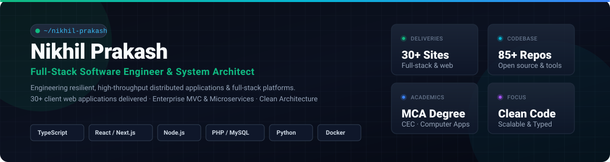

<p align="center">
  
</p>

<h1 align="center">Nikhil Prakash</h1>

<p align="center">
  <strong>Full-Stack Software Engineer &amp; System Architect</strong><br>
  <em>Engineering scalable web platforms, distributed APIs, and reliable database architectures</em>
</p>

<p align="center">
  <a href="https://www.nikhiljp.in/"></a>
  <a href="https://github.com/nikhilljpskj?tab=repositories"></a>
  <a href="https://www.linkedin.com/in/nikhil-prakash-069ab0171/"></a>
  <a href="mailto:nikhiljp.skj@gmail.com"></a>
  <a href="https://leetcode.com/u/nikhiljp/"></a>
  <a href="https://www.hackerrank.com/profile/nikhiljp_skj"></a>
</p>

<p align="center">
  📍 Pathanamthitta, Kerala, India &nbsp;|&nbsp; 🌐 IST (UTC+5:30) &nbsp;|&nbsp; 🚀 30+ Freelance Web Projects Delivered
</p>

---

## 👨‍💻 About Me

I am a full-stack software engineer with a strong focus on clean architecture, type safety, and maintainable systems. My engineering background spans building complete client web applications from concept to production, architecting domain-driven backend microservices and RESTful APIs, and implementing responsive, performant user interfaces.

- **Full-Stack Engineering:** Delivered 30+ freelance web applications, commercial portals, and business management systems using modern JavaScript/TypeScript, PHP, and Python.
- **Architectural Approach:** Strong adherence to separation of concerns, repository patterns, role-based access control (RBAC), and transactional integrity across relational and document databases.
- **Continuous Quality:** Deep focus on runtime performance, sub-second latency, clean debugging, automated deployments, and reproducible containerized environments.
- **Academics:** Master of Computer Applications (MCA) graduate from the College of Engineering Chengannur.

---

## 🛠️ Technical Expertise

### Languages & Runtimes
<p align="left">
  <a href="https://www.typescriptlang.org/" target="_blank" rel="noreferrer"></a>&nbsp;&nbsp;
  <a href="https://developer.mozilla.org/en-US/docs/Web/JavaScript" target="_blank" rel="noreferrer"></a>&nbsp;&nbsp;
  <a href="https://www.php.net/" target="_blank" rel="noreferrer"></a>&nbsp;&nbsp;
  <a href="https://www.python.org/" target="_blank" rel="noreferrer"></a>&nbsp;&nbsp;
  <a href="https://nodejs.org/" target="_blank" rel="noreferrer"></a>
</p>

### Frontend Engineering
<p align="left">
  <a href="https://react.dev/" target="_blank" rel="noreferrer"></a>&nbsp;&nbsp;
  <a href="https://nextjs.org/" target="_blank" rel="noreferrer"></a>&nbsp;&nbsp;
  <a href="https://tailwindcss.com/" target="_blank" rel="noreferrer"></a>&nbsp;&nbsp;
  <a href="https://getbootstrap.com/" target="_blank" rel="noreferrer"></a>&nbsp;&nbsp;
  <a href="https://developer.mozilla.org/en-US/docs/Web/HTML" target="_blank" rel="noreferrer"></a>&nbsp;&nbsp;
  <a href="https://developer.mozilla.org/en-US/docs/Web/CSS" target="_blank" rel="noreferrer"></a>
</p>

### Backend & Frameworks
<p align="left">
  <a href="https://expressjs.com/" target="_blank" rel="noreferrer"></a>&nbsp;&nbsp;
  <a href="https://laravel.com/" target="_blank" rel="noreferrer"></a>&nbsp;&nbsp;
  <a href="https://www.djangoproject.com/" target="_blank" rel="noreferrer"></a>
</p>

### Databases & Storage
<p align="left">
  <a href="https://www.postgresql.org/" target="_blank" rel="noreferrer"></a>&nbsp;&nbsp;
  <a href="https://www.mysql.com/" target="_blank" rel="noreferrer"></a>&nbsp;&nbsp;
  <a href="https://www.mongodb.com/" target="_blank" rel="noreferrer"></a>
</p>

### DevOps, Tooling & Systems
<p align="left">
  <a href="https://www.docker.com/" target="_blank" rel="noreferrer"></a>&nbsp;&nbsp;
  <a href="https://git-scm.com/" target="_blank" rel="noreferrer"></a>&nbsp;&nbsp;
  <a href="https://www.linux.org/" target="_blank" rel="noreferrer"></a>&nbsp;&nbsp;
  <a href="https://www.postman.com/" target="_blank" rel="noreferrer"></a>
</p>

---

## 🚀 Featured Engineering Projects

A selection of full-stack web applications, healthcare platforms, and business systems verified from public source repositories and live deployments:

| Project | Architecture & Focus | Tech Stack | Links |
| :--- | :--- | :--- | :--- |
| **Holter Monitoring Platform** | Production-ready medical SaaS with custom MVC architecture, 5-tier Role-Based Access Control (Admin, Staff, Hospital, Technician, Patient), PDO prepared statements, and automated patient diagnostics data workflows. | `PHP 8` `MySQL 8` `Custom MVC` `RBAC` `Bootstrap 5` | [📁 Source Code](https://github.com/nikhilljpskj/Holter-Monitoring) |
| **PortfoMeister** | Scalable portfolio generation platform with interactive theme customizer, rich UI component library, and automated Supabase database integration. | `React 18` `Supabase` `Material UI` `Styled Components` | [📁 Source Code](https://github.com/nikhilljpskj/PortfoMeister) &nbsp;•&nbsp; [🌐 Live App](https://portfo-meister001-git-master-nikhilljpskj.vercel.app/) |
| **Noolukettu Platform** | High-performance modern web application built on Next.js 16 and React 19, featuring modern CSS styling, fluid micro-interactions, and React Compiler optimization. | `Next.js 16` `React 19` `TypeScript 5` `Tailwind CSS 4` | [📁 Source Code](https://github.com/nikhilljpskj/Noolukettu) &nbsp;•&nbsp; [🌐 Live App](https://noolukettu.vercel.app) |
| **Audacix Game Engine** | Decoupled full-stack system featuring Django REST Framework backend with state machines, session management, and React interactive client. | `Python 3` `Django REST` `React` `REST API` | [📁 Source Code](https://github.com/nikhilljpskj/Audacix-Hangman) |
| **FalkenERP System** | Business enterprise platform implementing JWT authentication, modular route controllers, user permission profiles, and operational metrics dashboard. | `Node.js` `Express.js` `REST API` `JWT Auth` | [📁 Source Code](https://github.com/nikhilljpskj/FalkenERP) |
| **Field-Tracking Enterprise** | Real-time workforce management system with multi-department meeting scheduling, attendance logging, and schema migration pipelines. | `PHP` `MySQL` `SQL Migrations` `REST` | [📁 Source Code](https://github.com/nikhilljpskj/Field-Tracking) |

<details>
  <summary><strong>🔍 View Additional Verified Deliveries &amp; Demos</strong></summary>

- **[PSP E-Commerce Platform](https://psp-kappa.vercel.app)** — Multi-category online storefront with dynamic cart state and responsive checkout UI ([Source Code](https://github.com/nikhilljpskj/PSP)).
- **[Falken Ridge Corporate Portal](https://falken-ridge.vercel.app)** — Corporate business showcase site with animated UI components ([Source Code](https://github.com/nikhilljpskj/FalkenRidge)).
- **[CM Hospital Web Portal](https://cm-hospital.vercel.app)** — Healthcare facility portal with department overview and patient consultation contact flows ([Source Code](https://github.com/nikhilljpskj/CM-Hospital)).
- **[AdBullet Platform](https://ad-bullet.vercel.app)** — Digital advertising landing page and campaign showcase ([Source Code](https://github.com/nikhilljpskj/AdBullet)).
</details>

---

## 🎯 Engineering Focus & Problem Solving

```
const NikhilPrakash = {
    engineeringSpecialization: [
        "Distributed Web Architectures",
        "Full-Stack API Design & Optimization",
        "Relational Schema Design & Query Performance",
        "Role-Based Access Control (RBAC) & Authentication",
        "CI/CD Pipeline Automation & Containerization"
    ],
    technicalStandards: {
        typing: "Strict TypeScript end-to-end",
        architecture: "Domain-Driven / Clean MVC / Modular Services",
        dataIntegrity: "ACID compliance & parameterized database queries",
        deployment: "Zero-downtime, automated rollouts & containerized stacks"
    }
};
```

- **API Design & Integration:** Designing predictable RESTful interfaces, managing CORS, rate limiting, token-based authentication (JWT/OAuth), and resilient webhook processing.
- **Relational & Document Databases:** Schema normalization, foreign key constraints, indexing strategies, and database migrations with PostgreSQL and MySQL.
- **Frontend Precision & Performance:** Zero-layout-shift UI engineering, server components with Next.js, responsive layouts with modern Tailwind CSS, and minimal bundle sizes.
- **Production Reliability & Debugging:** Root-cause analysis, containerization with Docker, multi-stage builds, and structured logging.

---

## 📊 GitHub Activity & Statistics

<p align="center">
  
  &nbsp;
  
</p>

<!-- Optional Contribution Snake Animation (Automated via .github/workflows/snake.yml) -->
<picture>
  <source media="(prefers-color-scheme: dark)" srcset="https://raw.githubusercontent.com/nikhilljpskj/nikhilljpskj/output/github-contribution-grid-snake-dark.svg">
  <source media="(prefers-color-scheme: light)" srcset="https://raw.githubusercontent.com/nikhilljpskj/nikhilljpskj/output/github-contribution-grid-snake.svg">
  
</picture>

---

## 🎓 Education

- **Master of Computer Applications (MCA)**  
  *College of Engineering Chengannur (CEC)* &nbsp;•&nbsp; 2022 – 2024
- **Bachelor of Computer Applications (BCA)**  
  *Naipunnya School of Management, Cherthala* &nbsp;•&nbsp; 2018 – 2021

---

## 🤝 Connect With Me

Looking to build high-performance web applications, scale existing backend services, or discuss technical collaboration? Feel free to reach out:

<p align="left">
  <a href="https://www.nikhiljp.in/"></a>&nbsp;
  <a href="https://www.linkedin.com/in/nikhil-prakash-069ab0171/"></a>&nbsp;
  <a href="mailto:nikhiljp.skj@gmail.com"></a>&nbsp;
  <a href="https://leetcode.com/u/nikhiljp/"></a>&nbsp;
  <a href="https://www.hackerrank.com/profile/nikhiljp_skj"></a>
</p>

---

<p align="center">
  <sub>Crafted with clean code, verified technical assets, and zero expired dependencies.</sub>
</p>
